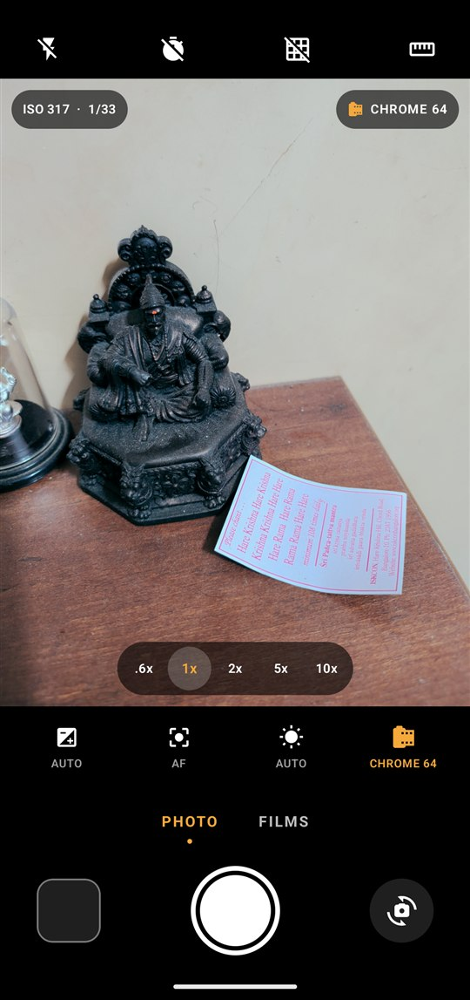
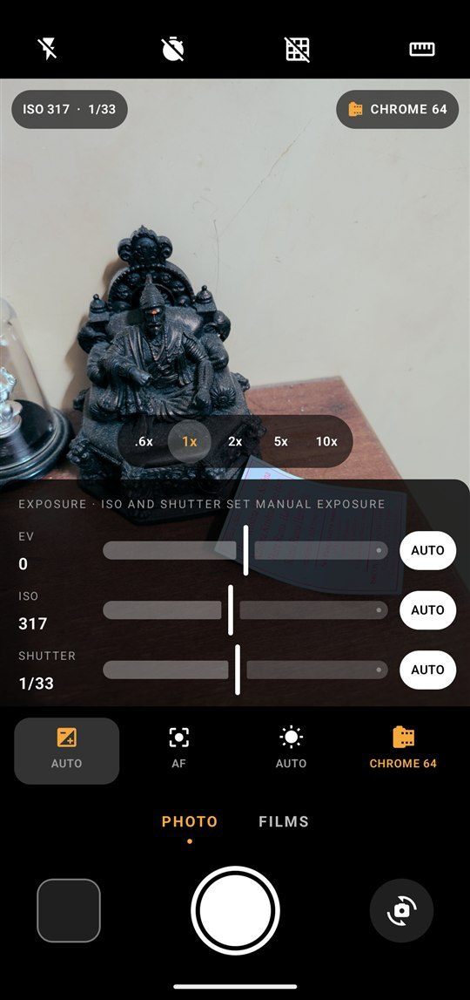
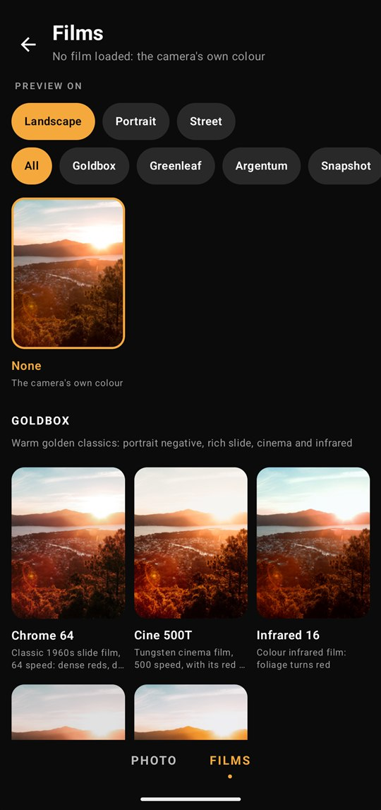
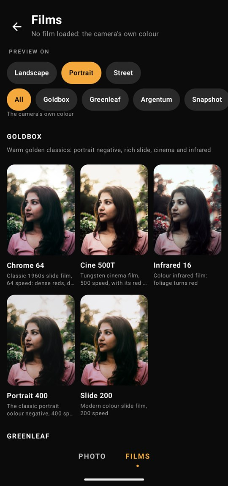

<h1 align="center">Emulsion</h1>

<p align="center">
  <b>A free, open-source film-emulation camera for Android.</b><br>
  Shoot through 43 analog-style films with a live preview, full manual controls and full-resolution photos.
</p>

<p align="center">
  <a href="https://github.com/ArnavDotExe/Emulsion/releases/latest"></a>
  <a href="https://github.com/ArnavDotExe/Emulsion/actions/workflows/android.yml"></a>
  <a href="https://github.com/ArnavDotExe/Emulsion/actions/workflows/colorlab.yml"></a>
  <a href="LICENSE"></a>
  
</p>

<p align="center">
  
  
  
  
</p>

Apps like Dazz Cam and Leica LUX don't exist on Android. Emulsion is a free one: pick a film,
frame the shot, and the preview already looks like the photo you will get. The colour science
behind it is open, measured against reference renders and hackable.

## Download

**[Get the APK from the latest release](https://github.com/ArnavDotExe/Emulsion/releases/latest)**,
then open it on your phone. Android asks you to allow installs from your browser or file manager
the first time. Needs Android 10 or newer; built and tested on a Pixel.

The APK is signed with the Emulsion release key. Its certificate's SHA-256 is
`4e043cd92e1563127b70c724e245004b5773d31cb2f756ad1d205bd4115bd073`; check it with
`apksigner verify --print-certs Emulsion-0.1.0.apk`.

## What it does

- **Films, not filters.** 43 looks, each a measured colour transform applied live on the GPU in
  the preview and at full resolution on the photo, so what you see is what you save.
- **A films tab.** Every film as a card on a landscape, a portrait or a street photo, grouped by
  the film it evokes. Tap one to load it.
- **Manual controls.** Exposure compensation, ISO, shutter speed, manual focus and white balance
  presets, with live readouts.
- **The basics, done well.** Tap to focus, pinch zoom and lens chips for whichever lenses your phone has, flash, self-timer,
  grid and a horizon level. Photos fill the same frame as the preview and save to `DCIM/Emulsion`
  in about 0.8 s.
- **Open and private.** No account, no ads, no network access: the app doesn't even ask for it.

## The films

Each film is a look: a 3D colour table plus a few finishing settings, in one small `.fsim.json`
file. They are grouped into houses by what they evoke:

| House | What it is | Looks |
|---|---|---|
| **Goldbox** | Warm golden classics: portrait negative, rich slide, cinema and infrared | Portrait 400, Chrome 64, Slide 200, Cine 500T, Infrared 16 |
| **Greenleaf** | Airy green-label film: pastel and pro negatives, clean slide | Pro Pastel 400 (1-4), Neg Standard Holiday, Neg High Memory, Slide Clean Blue |
| **Argentum** | Silver black and white | Fine Mono 100 |
| **Snapshot** | Instant prints, soft and muted | Instant Muted |
| **Old Europe** | Early colour film from the 1940s | Colour 1940s |
| **Studio** | Everyday analog colour and faded retro prints | Analog 1-7, Retro Fade 1-2, Deep Black, Vivid |
| **Recipes** | Digital film recipes for street, portrait and landscape | Blush, Cinematic, Coffee, Dark, Drama, Editorial, Fresh, Low Light, Sepia, Sky, Warm |

Looks with a grain variant (Portrait 400, Slide 200, Fine Mono 100, Infrared 16, Instant Muted,
Colour 1940s) ship both. Today the app applies each look's colour; its vignette, grain and local
contrast settings are stored in the file and are next on the roadmap.

### Use and change the looks

The looks are plain files in
[`android/app/src/main/assets/looks/`](android/app/src/main/assets/looks/). Copy one, change it,
rebuild the app and it appears in the films tab:

```json
{
  "format": "fsim", "version": 1,
  "name": "Warm Fade", "description": "...", "author": "You", "license": "GPL-3.0-or-later",
  "color": { "lut": { "size": 33, "data": "<base64 of the 3D table>" } },
  "local": { "clarity": 10, "shadows": 20 },
  "vignette": { "amount": -20 },
  "grain": { "amount": 15, "size": 30 }
}
```

- **Settings** (`local`, `vignette`, `grain`) are plain numbers in Lightroom slider units: edit
  them in any text editor.
- **Colour** is the `color.lut` table: `size` points per axis, base64 of little-endian 16-bit
  values in `.cube` order. The [color lab](tools/colorlab/) makes one from a Lightroom preset
  (`colorlab look preset.xmp my-look.fsim.json`) and can write a preset's colour as a `.cube` LUT (`colorlab lut`).
- The format is strict (unknown keys and out-of-range values are rejected, so a look never renders
  wrongly in silence). Its full description is in
  [`tools/colorlab/src/colorlab/fsim.py`](tools/colorlab/src/colorlab/fsim.py); the app's reader is
  [`FsimReader`](android/look/src/main/kotlin/io/github/arnavdotexe/filmsim/look/FsimReader.kt).
- Looks you share must be yours to share. Don't put presets you don't have the rights to in a pull
  request.

## What's here

| Path | What it is |
|---|---|
| [`android/`](android/) | The Android app (Kotlin, Jetpack Compose, CameraX, OpenGL ES 3) and its `:look` module, tested against the color lab |
| [`android/app/src/main/assets/looks/`](android/app/src/main/assets/looks/) | The bundled looks, as `.fsim.json` files |
| [`android/app/src/main/assets/demo/`](android/app/src/main/assets/demo/CREDITS.md) | The three photos the films tab previews on, with their credits |
| [`tools/colorlab/`](tools/colorlab/) | Python reference implementation of the colour science: colour spaces, 3D LUTs, Lightroom preset reading, tone, HSL, grading, grain, vignette |
| [`docs/`](docs/) | Design notes, test evidence and the screenshots |

## Roadmap

1. **Colour lab** (done): the reference film pipeline (tone, curves, HSL, colour grading, look
   tables, local contrast, grain, vignette), checked against Lightroom renders.
2. **Android app** (in progress): the colour runs live in the preview and on captures. Next:
   vignette, grain and local contrast in the app, with conformance tests against the lab.
3. **Cameras**: recipes combining a look, grain, light leaks, dust, frames and date stamps, with
   every overlay generated procedurally.
4. **Editor**: apply looks to existing photos; import `.xmp`, `.dng`, `.cube` and `.fsim` looks.
5. More film simulations, RAW processing, burst merge and a night mode.

## Build the app

Needs JDK 21 and the Android SDK (platform 37), with `sdk.dir` in `android/local.properties`:

```bash
cd android
./gradlew :look:test :app:testDebugUnitTest   # the look module against the lab's fixtures, and the app's logic
./gradlew :app:assembleDebug                  # app/build/outputs/apk/debug/app-debug.apk
./gradlew :app:assemblePreview                # a shrunk (~13 MB) build to hand to testers
```

## Develop the colour lab

```bash
cd tools/colorlab
python -m venv .venv
# Windows: .venv\Scripts\activate    macOS/Linux: source .venv/bin/activate
pip install -e ".[dev]"
pytest --cov
```

Python 3.11 or newer. Coverage must stay at or above 80%.

The install adds a `colorlab` command (also `python -m colorlab`):

```bash
colorlab info my-preset.xmp                       # the look and the sliders a preset moves
colorlab render my-preset.xmp photo.tif out.tif   # the whole preset on an sRGB TIFF
colorlab lut my-preset.xmp my-look.cube           # its global colour as a 3D LUT
colorlab look my-preset.xmp my-look.fsim.json     # an Emulsion look file
colorlab apply my-look.fsim.json photo.tif out.tif
colorlab --help                                   # and the calibration tools
```

## Contributing

Issues and pull requests are welcome: see [CONTRIBUTING.md](CONTRIBUTING.md).

## Credits

- The camera screen's layout is inspired by [PhotonCamera](https://github.com/eszdman/PhotonCamera)
  (GPL-3.0) and the Aperture camera; no code was taken from either.
- Film halation and grain (`colorlab.film`) are ported from
  [spektrafilm](https://github.com/andreavolpato/spektrafilm) by Andrea Volpato (GPL-3.0) and from
  [darktable](https://www.darktable.org/)'s port of it (GPL-3.0-or-later).
- The films tab's demo photos are from [Pexels](https://www.pexels.com) (Pexels License), by Arthur
  Brognoli, Sai Krishna Sudevan and Boys in Bristol Photography. See
  [`CREDITS.md`](android/app/src/main/assets/demo/CREDITS.md).

## License

[GPL-3.0-or-later](LICENSE). Fork it, improve it, and keep it open.

Emulsion isn't affiliated with Dazz Cam, Leica, Fujifilm or Adobe. Their names are used only to
describe what this project is inspired by or interoperates with.
